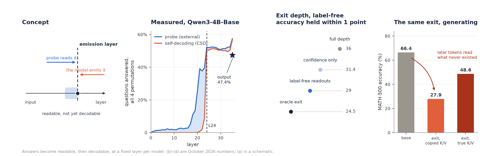

# Brewing：`unsupervised-metrics` 分支

[English](README.md)

[](https://arxiv.org/abs/2606.17648)
[](requirements.txt)
[](docs/REPRODUCTION.md)



Brewing 研究 LLM 的答案在深度上何时形成。每一层用两种读法把它夹住：交叉验证的线性 probe 判断答案能否从隐状态中读出，即**外部可解码**；上下文剥离解码（CSD，Patchscope 的一种）判断模型自己剩下的层能否把它解码出来，即**自身可解码**。前一个条件总是先成立，后一个要晚几层。

**发射层（emission layer）。** 每个模型都有一层，答案在这一层被一步写进可直接读出的输出方向。在它之前，probe 已能读出答案，但答案不在四个字母的读出方向上；到了这一层，模型自己的读出跳到答案。这一层是模型固定的：不随题目来源、结局类别或后训练变化（Qwen3-4B 在 L24，Qwen2.5-7B 在 L19 到 L20，Llama-3.1-8B 在 L17）。

本分支是 EACL 论文（[arXiv 2606.17648](https://arxiv.org/abs/2606.17648)）在 2026 年 10 月的后续工作的代码与数据。论文用的是 6 类合成代码推理任务；这一轮换到跨域选择题，检验免金标签的读数能否替代训练出的 probe，以及这些读数能否指导早退和层循环（loop）。脚本就是产出 10 月数字的那一批，只把本机路径改成了可配置。思路演变见 [docs/TRAJECTORY.md](docs/TRAJECTORY.md)。

## 一张表看结果

答案位置，5,659 道题 × 4 个选项循环置换版本。四个版本指向同一内容才计入。

| 模型与格式 | 准确率 | R | O | U | M | NB | probe 可读（中位层） | 自身可解码（中位层） |
|---|---|---|---|---|---|---|---|---|
| Qwen3-4B-Base，1-shot | 66.1% | 47.4% | 1.4% | 4.2% | 0.1% | 46.8% | 21 | 24 |
| Qwen3-4B，1-shot | 59.1% | 37.6% | 0.5% | 5.4% | 0.0% | 56.4% | 21 | 24 |
| Qwen3-4B，chat | 56.8% | 32.1% | 0.3% | 8.1% | 0.0% | 59.5% | 21 | 24 |
| Qwen2.5-7B，1-shot | 62.5% | 43.8% | 0.8% | 4.2% | 0.2% | 51.1% | 19 | 20 |
| Qwen2.5-7B-Instruct，chat | 58.6% | 37.5% | 0.4% | 4.7% | 0.0% | 57.3% | 19 | 19 |
| Llama-3.1-8B，1-shot | 41.0% | 14.8% | 0.9% | 6.7% | 0.0% | 77.5% | 15 | 17 |

R：自身可解码且最终正确。O：曾经自身可解码，最终丢失。U：probe 可读，但始终不能自身解码。M：probe 可读，但稳定地错。NB：probe 始终读不出。中位层按 R 类题统计。

干预的结果：

- **免金标签的读出可行。** 用模型自己在四个置换版本上的多数答案训练读出头，不用金标签，在 Qwen3 两条线上逐层准确率与金标签 probe 相差不到 0.6 个点。
- **答案位置上的早退只省算力。** 要求与满深度输出 99% 一致时，用 CSD 跳变等特征的规则在 Qwen3-4B chat 上平均停在第 25.2 层（只看置信度是 30.7，oracle 是 23.5）。准确率变化在一个点以内，在诱饵对照下没有任何规则能把错题改对。
- **重复中段层几乎没用。** 后训练模型收益不到一个点，base 模型没有收益。没有任何免标签门控胜过"每题都 loop"。
- **生成里两个动作都失败。** 即使退出决定从不改变发出的 token，MATH-500 正确率也从 66.4% 掉到 27.9%：后面的 token 要读被早退 token 的深层 K/V，冻结模型从没见过这种值。预先指定的 loop 主检验降了 3.3 个点。

瓶颈在冻结模型上执行动作，而不在判断何时动作。

## 目录

```
scripts/depth_intervention/   答案位置：提取、probe、分类、早退、loop、免标签特征
scripts/gen_depth/            生成阶段：逐 token 变深度解码器、策略、判分、对比
scripts/make_subset.py        分层抽样的题目子集
scripts/_workspace.py         数据与模型路径
experiments/depth_intervention/data/bench/   题集、few-shot 示例、各模型的 few-shot 设置
experiments/gen_depth/data/   生成题池和固定的选题列表
vendor/gen_depth_grading/     内置的 math_verify 判分器
docs/                         复现指南、研究脉络、10 月原始日志
```

运行结果写到 `experiments/<study>/results/`，不进 git。

## 快速开始

```bash
pip install -r requirements.txt
export BREWING_MODEL_ROOT=/path/to/models   # 含 Qwen3-4B-Base/、Qwen3-4B/、Meta-Llama-3.1-8B-nous/、huggingface/Qwen/...
export BREW_BENCH=core500                   # 500 题子集；去掉则用全集

cd experiments/depth_intervention
python scripts/extract.py          --model qwen3-4b-base --fmt base_fewshot
python scripts/save_lens_params.py --model qwen3-4b-base --fmt base_fewshot
python scripts/train_probe.py      --model qwen3-4b-base --fmt base_fewshot
python scripts/classify.py         --model qwen3-4b-base --fmt base_fewshot --probe full --csd raw --last_layer output --out classify
python scripts/early_exit.py       --model qwen3-4b-base --fmt base_fewshot --probe full --classify_dir classify
```

在一张 RTX 4090 上，子集跑到这一步每个模型约三分钟。完整步骤、loop 与生成阶段、预期数字以及与 10 月的核对方式，见 [docs/REPRODUCTION.md](docs/REPRODUCTION.md)。
